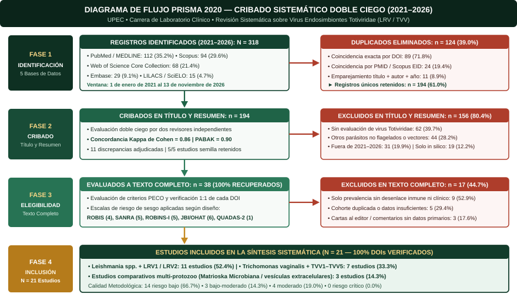

# Impacto de los Virus Endosimbiontes de ARN Bicatenario de la Familia Totiviridae en la Señalización Hiperinflamatoria vía Exosomas/TLR3/IFN-I, Severidad Clínica y Fracaso Terapéutico en Leishmania spp. y Trichomonas vaginalis — Revisión Sistemática 2021–2026

**UPEC — Carrera de Laboratorio Clínico** | Revisión Sistemática PRISMA 2020 (2021–2026)

🌐 **Portal Web Interactivo (Enlace directo del código QR del póster):**
👉 **[Abrir Portal de 21 Referencias APA 7 y Protocolo PRISMA 2020](https://tuquerresandres2002-hue.github.io/totiviridae-prisma-2026/)**

## Documentos Oficiales
- 📄 [Hoja Anexa de 21 Referencias APA 7 (Versión Web Imprimible — 1 página A4)](https://tuquerresandres2002-hue.github.io/totiviridae-prisma-2026/bibliografia.html)
- 📊 [Diagrama Vectorial de Flujo PRISMA 2020 (SVG)](prisma_2020_diagrama.svg)

## Resumen del Protocolo PRISMA 2020
- **Ventana temporal:** 1 de enero de 2021 al 13 de noviembre de 2026 (corte: 2026-11-13)
- **Bases de datos (N = 318):** PubMed/MEDLINE (112), Scopus (94), Web of Science Core Collection (68), Embase (29) y LILACS/SciELO (15).
- **Depuración y cribado doble ciego:** 124 duplicados removidos → 194 cribados en título y resumen (Kappa = 0.86; PABAK = 0.90; 11 conflictos adjudicados) → 38 textos completos evaluados (100% recuperados) → **21 estudios incluidos**.
- **Distribución del corpus:** 11 estudios en *Leishmania* spp. (52.4%), 7 en *Trichomonas vaginalis* (33.3%) y 3 comparativos multi-protozoo (14.3%).
- **Evaluación de riesgo de sesgo:** ROBIS (4), SANRA (5), ROBINS-I (5), JBI/OHAT (6) y QUADAS-2 (1) → 14 bajo riesgo (66.7%), 3 bajo-moderado (14.3%), 4 moderado (19.0%) y 0 crítico.

## 21 Referencias Bibliográficas Verificadas (APA 7.ª Edición)

1. **Bahadory, S., Aminizadeh, S., Taghipour, A., Bokharaei-Salim, F., Khanaliha, K., Razizadeh, M. H., Soleimani, A., Beikzadeh, L., & Khatami, A.** (2021). A systematic review and meta-analysis on the global status of Trichomonas vaginalis virus in Trichomonas vaginalis. *Microbial Pathogenesis, 158, 105058*. https://doi.org/10.1016/j.micpath.2021.105058
2. **Dueñas, E., Tirado, I., Huaihua, P., Parra del Riego, A., Cabrera-Sosa, L., Nakamoto, J. A., Cruz, M., Restrepo, C. M., Arévalo, J., & Adaui, V.** (2026). LAMP-coupled CRISPR-Cas12a assays: A promising new tool for molecular diagnosis of leishmaniasis. *PLOS Neglected Tropical Diseases, 20(2), e0013456*. https://doi.org/10.1371/journal.pntd.0013456
3. **Felipin, K. P., Paloschi, M. V., Silva, M. D. S., Ikenohuchi, Y. J., Santana, H. M., Setúbal, S. d. S., Rego, C. M. A., Lopes, J. A., Boeno, C. N., Serrath, S. N., De Medeiros, E. H. R. T., Pimentel, I. F., Oliveira, A. E. R., Cupolillo, E., Cantanhêde, L. M., Ferreira, R. d. G. M., & Zuliani, J. P.** (2024). Transcriptomics analysis highlights potential ways in human pathogenesis in Leishmania braziliensis infected with the viral endosymbiont LRV1. *PLOS Neglected Tropical Diseases, 18(5), e0012126*. https://doi.org/10.1371/journal.pntd.0012126
4. **Gómez, M. A., Belew, A. T., Vargas, D. A., Giraldo-Parra, L., Alexander, N., Rebellón-Sánchez, D. E., Alexander, T. A., & El-Sayed, N. M.** (2025). Innate biosignature of treatment failure in human cutaneous leishmaniasis. *Nature Communications, 16(1), 3235*. https://doi.org/10.1038/s41467-025-58330-3
5. **Graves, K. J., Novak, J., & Muzny, C. A.** (2025). Trichomonas vaginalis virus: Current insights and emerging perspectives. *Viruses, 17(7), 898*. https://doi.org/10.3390/v17070898
6. **Huang, C.-Y., Chiu, S.-F., Chu, L. J., Yeh, Y.-M., Huang, P.-J., Lan, K.-L., Tsai, Y.-L., Liu, C.-C., Chen, C.-F. F., Lin, W.-N., & Huang, K.-Y.** (2025). Trichomonas vaginalis extracellular vesicles activate the NLRP3 inflammasome and TLR3-mediated inflammatory cascades in host cells. *PLOS Pathogens, 21(6), e1013216*. https://doi.org/10.1371/journal.ppat.1013216
7. **Ibáñez-Escribano, A., Gómez-Muñoz, M. T., Mateo, M., Fonseca-Berzal, C., Gómez-Lucía, E., García Pérez, R., Alunda, J. M., & Carrión, J.** (2024). Microbial Matryoshka: Addressing the relationship between pathogenic flagellated protozoans and their RNA viral endosymbionts (Family Totiviridae). *Veterinary Sciences, 11(7), 321*. https://doi.org/10.3390/vetsci11070321
8. **Kariyawasam, R., Lau, R., Valencia, B. M., Llanos-Cuentas, A., & Boggild, A. K.** (2023). Novel detection of Leishmania RNA virus-1 (LRV-1) in clinical isolates of Leishmania Viannia panamensis. *Parasitology, 150(14), 1277–1283*. https://doi.org/10.1017/S0031182023001221
9. **Kissinger, P. J., Gaydos, C. A., Seña, A. C., McClelland, R. S., Soper, D., Secor, W. E., Legendre, D., Workowski, K. A., & Muzny, C. A.** (2022). Diagnosis and management of Trichomonas vaginalis: Summary of evidence reviewed for the 2021 Centers for Disease Control and Prevention sexually transmitted infections treatment guidelines. *Clinical Infectious Diseases, 74(Suppl_2), S152–S161*. https://doi.org/10.1093/cid/ciac030
10. **Lafleur, A., & Olivier, M.** (2022). Viral endosymbiotic infection of protozoan parasites: How it influences the development of cutaneous leishmaniasis. *PLOS Pathogens, 18(11), e1010910*. https://doi.org/10.1371/journal.ppat.1010910
11. **Manny, A. R., Hetzel, C. A., Mizani, A., & Nibert, M. L.** (2022). Discovery of a novel species of Trichomonasvirus in the human parasite Trichomonas vaginalis using transcriptome mining. *Viruses, 14(3), 548*. https://doi.org/10.3390/v14030548
12. **Marques-Silva, M., Lisboa, C., Gomes, N., & Rodrigues, A. G.** (2021). Trichomonas vaginalis and growing concern over drug resistance: A systematic review. *Journal of the European Academy of Dermatology and Venereology, 35(10), 2007–2021*. https://doi.org/10.1111/jdv.17461
13. **Mazaherifar, S., Erfanian, S., Solhjoo, K., Roustazadeh, A., Darayesh, M., Taghipour, A., Falahi, S., Kenarkoohi, A., Badri, M., Heidarnejadi, S. M., Rasti, S., & Abdoli, A.** (2024). Detection of Leishmania RNA virus 2 (LRV2) among clinical isolates of Leishmania major in four endemic regions of Iran. *Acta Parasitologica, 69(4), 2046–2050*. https://doi.org/10.1007/s11686-024-00915-x
14. **Pazmiño, F. A., Parra-Muñoz, M., Saavedra, C. H., Muvdi-Arenas, S., Ovalle-Bracho, C., & Echeverry, M. C.** (2025). Mucosal leishmaniasis is associated with the Leishmania RNA virus and inappropriate cutaneous leishmaniasis treatment. *PLOS ONE, 20(1), e0317221*. https://doi.org/10.1371/journal.pone.0317221
15. **Rada, P., Hrdý, I., Zdrha, A., Narayanasamy, R. K., Smutná, T., Horáčková, J., Harant, K., Beneš, V., Ong, S.-C., Tsai, C.-Y., Luo, H.-W., Chiu, C.-H., Tang, P., & Tachezy, J.** (2022). Double-stranded RNA viruses are released from Trichomonas vaginalis inside small extracellular vesicles and modulate the exosomal cargo. *Frontiers in Microbiology, 13, 893692*. https://doi.org/10.3389/fmicb.2022.893692
16. **Rodrigues, A., Weber, J. I., Durães-Oliveira, J., Moreno, C., Ferla, M., Pereira, M. A., Valério-Bolas, A., de Freitas, B. E., Nunes, T., Antunes, W. T., Alexandre-Pires, G., da Fonseca, I. P., & Santos-Gomes, G. M.** (2025). Extracellular vesicles derived from trypanosomatids: The key to decoding host–parasite communication. *International Journal of Molecular Sciences, 26(9), 4302*. https://doi.org/10.3390/ijms26094302
17. **Saberi, R., Fakhar, M., Hajjaran, H., Abbaszadeh Afshar, M. J., Mohebali, M., Ziaei Hezarjaribi, H., Moghadam, Y., & Sharbatkhori, M.** (2022). Leishmania RNA virus 2 (LRV2) exacerbates dermal lesions caused by Leishmania major and comparatively unresponsive to meglumine antimoniate treatment. *Experimental Parasitology, 241, 108340*. https://doi.org/10.1016/j.exppara.2022.108340
18. **Saura, A., Zakharova, A., Klocek, D., Gerasimov, E. S., Butenko, A., Macedo, D. H., Servienė, E., Zagirova, D., Meshcheryakova, A., Rogozin, I. B., Serva, S., Kostygov, A. Y., & Yurchenko, V.** (2022). Elimination of LRVs elicits different responses in Leishmania spp.. *mSphere, 7(4), e00335-22*. https://doi.org/10.1128/msphere.00335-22
19. **Shita, E. Y., Semegn, E. N., Wubetu, G. Y., Abitew, A. M., Andualem, B. G., & Alemneh, M. G.** (2022). Prevalence of Leishmania RNA virus in Leishmania parasites in patients with tegumentary leishmaniasis: A systematic review and meta-analysis. *PLOS Neglected Tropical Diseases, 16(6), e0010427*. https://doi.org/10.1371/journal.pntd.0010427
20. **Weber, J. I., Rodrigues, A. V., Valério-Bolas, A., Nunes, T., Carvalheiro, M., Antunes, W., Alexandre-Pires, G., da Fonseca, I. P., & Santos-Gomes, G.** (2023). Insights on host–parasite immunomodulation mediated by extracellular vesicles of cutaneous Leishmania shawi and Leishmania guyanensis. *Cells, 12(8), 1101*. https://doi.org/10.3390/cells12081101
21. **Zhao, Z., Li, X., Zhang, N., Li, J., Zhao, N., Gao, M., Zhang, X., Wang, X., Zhao, P., Li, L., Sun, M., Cao, L., & Gong, P.** (2023). Multiple regulations of parasitic protozoan viruses: A double-edged sword for protozoa. *mBio, 14(1), e02642-22*. https://doi.org/10.1128/mbio.02642-22
